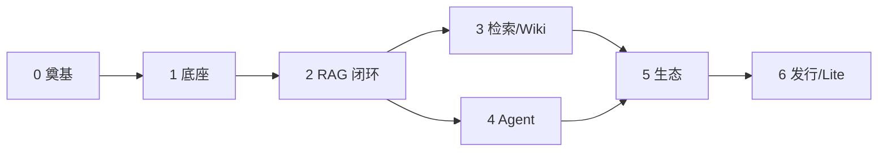

# Sail Nora

基于腾讯开源 [WeKnora](https://github.com/Tencent/WeKnora)（MIT）的 **全功能 .NET 实现**：用 **C# 重写 Go 主服务**，**前端与 Python 文档解析服务与上游保持一致**，目标是在不改 Vue 控制台的前提下，用 ASP.NET Core 进程替换原 `app`。

> 上游基线：**WeKnora v0.9.0**  
> 工程纲领：[`doc/00-全局总任务纲领.md`](./doc/00-全局总任务纲领.md)

---

## 意图

WeKnora 把团队知识汇集起来，同一套知识库支撑三类能力：

| 能力 | 含义 |
|------|------|
| **RAG** | 混合检索 + 重排 + 流式问答，回答可引用原文 |
| **Agent** | 多步推理，调用检索、沙箱、MCP、技能、本机浏览器等 |
| **Wiki** | 从文档整理可浏览 Wiki 与图谱，支持版本回滚 |

**Sail Nora** 要做的不是“另一套知识库 Demo”，而是：

1. **契约兼容**：`/api/v1`、SSE、鉴权/RBAC、任务类型、docreader gRPC 与上游对齐，现有前端可直接对接。  
2. **能力对齐**：对标 Standard 版全功能（含可选向量库、对象存储、Neo4j、Langfuse 等 profile），而非裁剪版。  
3. **栈可替换**：主服务落在 .NET 生态，便于在 Windows / 企业内网 / 现有 .NET 体系中部署与二次开发。  
4. **合规溯源**：尊重 WeKnora MIT 许可与第三方声明。

```text
Web UI / CLI / IM / Embed / MCP 客户端
              │
              ▼
     Sail Nora (.NET app) :8080     ← 本仓库重写部分
              │
    ┌─────────┼─────────┐
    ▼         ▼         ▼
 docreader  模型/沙箱   PG · Redis · 向量库 · 对象存储
 (Python)   (外挂)      (与上游同拓扑)
```

---

## 做什么 / 不做什么

| 范围 | 策略 |
|------|------|
| Go `cmd/server` + `internal/**` | **C# 重写**（ASP.NET Core） |
| Go CLI / SDK / 桌面壳 | 后期移植，不阻塞主服务 |
| `frontend/`（Vue 3） | **同源复用，不重写** |
| `docreader/`（Python gRPC） | **同源复用，不重写** |
| DB migrations / API 契约 | **语义兼容**，优先复用上游 SQL 与 Swagger |

**非目标**：换 Blazor 前端、用 C# 重写 docreader、为省事改 API/SSE 逼前端跟着改、默认可砍掉 Agent/Wiki/数据源等 Standard 能力。

---

## 技术选型（当前）

| 项 | 选择 |
|----|------|
| 主服务 | ASP.NET Core，多目标 **`net8.0` · `net10.0` · `net11.0`** |
| 前端 / 解析 | `src/sync/frontend` + `src/sync/docreader`（只读同步） |
| 源码布局 | 全部在 `src/`；只读进 `src/sync/`（[ADR-0002](./doc/ADR/0002-src目录与上游对齐.md)） |
| 数据与队列 | PostgreSQL（ParadeDB）优先；Redis 队列语义对齐 asynq；Lite/SQLite 靠后 |
| 兼容硬指标 | HTTP/SSE/WS · JWT/API Key/Embed/MCP · RBAC · capabilities |

决策记录见 [`doc/ADR/0001-tfm与上游同步.md`](./doc/ADR/0001-tfm与上游同步.md)。

---

## 路线图

阶段可并行准备，**对外宣称能力**须过门禁。细节与验收标准见纲领第 6 节。

| 阶段 | 主题 | 门禁（摘要） |
|------|------|----------------|
| **0** 当前 | 纲领、多 TFM 骨架、上游同步脚本、契约测试脚手架 | 空主机可构建；health 冒烟 |
| **1** | 平台底座：配置、迁移、登录/空间/RBAC、存储、SSE 底座 | 前端可登录进空间 |
| **2** | 知识库闭环：上传 → docreader → 分块向量化 → RAG SSE | 问答与引用可用 |
| **3** | 检索增强、多模态、Wiki | 知识库设置与 Wiki 主路径 |
| **4** | Agent：工具、技能、MCP、HITL、沙箱 | Agent 对话与工具事件对齐 |
| **5** | 数据源、IM、Embed、记忆、自动化、协作、可观测 | v0.9.0 差异表清零或明示延期 |
| **6** | Compose/Helm 替换发行、CLI/SDK、Lite、加固 | 可对外替换部署 |



---

## 仓库结构

**所有源码在 `src/`**。无需改造资产在 [`src/sync/`](./src/sync/)（与上游同名）；C# 重写在 `cmd/` / `internal/` 等（见 [`src/README.md`](./src/README.md)）。

```text
sail-nora/
├── README.md
├── doc/
└── src/
    ├── sync/                 # 只读同步（frontend、docreader、migrations…）
    ├── cmd/server/           # C# Host（建设中）
    ├── internal/             # C# 核心
    ├── cli/ · client/
    ├── docker/ · deploy/ · helm/
    ├── scripts/sync-upstream.ps1
    └── UPSTREAM_VERSION
```

---

## 文档

| 文档 | 说明 |
|------|------|
| [全局总任务纲领](./doc/00-全局总任务纲领.md) | 范围、兼容契约、阶段与 WBS |
| [文档索引](./doc/README.md) | 分册与 ADR 目录 |
| [ADR-0001](./doc/ADR/0001-tfm与上游同步.md) | TFM 与上游同步方式 |
| [ADR-0002](./doc/ADR/0002-src目录与上游对齐.md) | `src/` 与上游 1:1 切分 |
| [src/README.md](./src/README.md) | 同步/重写目录角色表 |

上游工程导读：[WeKnora `docs/architecture.md`](https://github.com/Tencent/WeKnora/blob/main/docs/architecture.md) · [产品文档](https://weknora.weixin.qq.com/docs/)

---

## 状态

**早期筹备**：纲领与 `src/sync/` 首轮只读资产已落地；.NET Host 尚未实现。

---

## 许可证

- 上游 [WeKnora](https://github.com/Tencent/WeKnora) © Tencent，**MIT**（另含第三方组件声明）。  
- 本仓库衍生实现将保持 MIT 兼容，并保留版权与 NOTICE 溯源；完整声明随代码与同步资产一并补齐。
)
