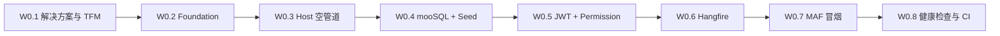

# 实施 ①：骨架复刻适配

> 目标：在 sail-nora 中落地一套**可运行的后端骨架**，范式对齐 **sleveen-admin**，目录服从 **ADR-0002**（源码在 `src/`，只读资产在 `src/sync/`）。  
> 完成定义（DoD）：`dotnet build` 多 TFM 通过；进程可启动；`/health`、登录/刷新、Permission 探针、mooSQL 读写、Hangfire Dashboard（可关）、MAF 流式冒烟任一可用。  
> 参考：[选型总览](../.net选型/00-选型总览.md) · [ADR-0003](../ADR/0003-dotnet选型与sleveen-admin对齐.md) · admin `PLAN.md` / `doc/mooSQL-integration.md`

---

## 1. 原则

| 原则 | 说明 |
|------|------|
| **复刻范式，不搬巨石** | 拷贝/改写 Foundation 级能力与 Host 管道；**不**引入 Sailflow、无界门户、officeman、Soybean 壳 |
| **命名独立** | 项目/命名空间用 `SailNora.*`，避免与 admin 程序集冲突 |
| **路径服从 ADR-0002** | Host → `src/cmd/server`；平台与产品代码 → `src/internal/...`；sync 只读 |
| **表结构双轨意识** | 平台表（用户/角色/令牌等）可按 admin 惯例用 mooSQL DDL/Seed；**WeKnora 业务表**后续以 `src/sync/migrations` 为准 |
| **前端本阶段** | 不以 WeKnora UI 打通为门禁；用 Swagger / 最小 HTTP 客户端验证平台 API |

---

## 2. 目标解决方案树

```text
src/
├── SailNora.sln
├── Directory.Build.props              # TargetFrameworks=net8.0;net10.0;net11.0
├── cmd/
│   └── server/                        # SailNora.App（原 Web.Api 角色）
│       ├── Program.cs
│       ├── Configuration/             # Jwt.json · DBCoonfig.json · Hangfire.json · Ai.json · Redis.json …
│       ├── Auth/ · Scheduling/ · Swagger/
│       └── SailNora.App.csproj
├── internal/
│   ├── foundation/                    # SailNora.Foundation
│   │   └── AspNet · Auth · Data · DI · Models · Options · Security …
│   ├── platform/                      # SailNora.Platform（原 System 精简）
│   │   └── Auth · User · Role · Menu? · Tenant/Space · File · Bootstrap
│   └── product/                       # SailNora.Product（空壳或占位，功能段再填）
│       └── Ai/                        # MAF 最小聊天（可先放 platform/product）
├── sync/                              # 已有，只读
└── scripts/
```

> 若希望 csproj 更贴近 admin 的 `backend/core` 扁平结构，允许 `src/internal/SailNora.Foundation` 单层目录，但须在本文与 `src/README` 登记映射；**推荐**上表，便于对照 Go `internal/*`。

**依赖方向（硬约束，同 admin）**

```text
SailNora.Platform  → SailNora.Foundation
SailNora.Product   → SailNora.Foundation
SailNora.App       → Platform + Product + Foundation
```

**外部 ProjectReference（与 admin 同级仓）**

```xml
<!-- 相对 sail-nora 根示例；实施时按实际相对路径校正 -->
..\..\moo-sqlm\mooSQL2024\ext\mooSQL.Ext.csproj
..\..\hangfire.moo-sql\src\Hangfire.MooSql\Hangfire.MooSql.csproj
```

---

## 3. 从 admin 复刻清单（含 / 改 / 弃）

### 3.1 Foundation — 建议「改编复刻」

| admin 来源 | 动作 | sail-nora 落点 |
|------------|------|----------------|
| `Models/ApiResult*` · `ApiResultCodes` | **复刻**（可改名前缀无关） | `foundation/Models` |
| `AspNet/*` 过滤器、全局异常 | **复刻** | `foundation/AspNet` |
| `Auth/Permission*` · Jwt 辅助 · `IAuthUserContext` | **复刻并改命名空间** | `foundation/Auth` |
| `Data/MooSqlSetup` · `MooRepository` | **复刻适配**连接配置键 | `foundation/Data` |
| `DI` 标记 · Scrutor 扩展 | **复刻** | `foundation/DI` |
| `Options`（Jwt/DB/…） | **复刻精简** | `foundation/Options` |
| `Ids/GuidV7` | 可选；WeKnora 业务主键多为上游类型时平台表可用 Guid | `foundation/Ids` |
| `Storage/LocalFileStorage` | **复刻最小** | `foundation/Storage` |
| `Tenant` | **评估后适配**为「空间」Claims，勿照搬多租户产品细节 | `foundation` 或 `platform` |
| Biz 页面基类全家桶 | **暂缓**（WeKnora 前端不是 Biz_ 范式） | — |

### 3.2 Platform（原 System）— 「精简复刻」

| 能力 | 动作 | 说明 |
|------|------|------|
| AuthService 登录/刷新/登出 | **复刻精简** | 验证码可先关或可选 |
| User / Role / 权限码 | **复刻精简** | 满足 `[Permission]` 与菜单可后置 |
| Bootstrap / DbInitializer / Seed | **复刻精简** | 种子管理员 + 基础角色 |
| Menu 动态路由树 | **可后置** | 本阶段不接 WeKnora 菜单 |
| Notice / Online SignalR / AuthBag 全量 | **弃或极后** | 非 WeKnora P0 |
| 多租户管理全套 | **改为空间（Tenant）最小模型** | 为阶段②预留 `X-Tenant-ID` / 空间 Claims |

### 3.3 Host（Web.Api → cmd/server）— 「管道复刻」

| 项 | 动作 |
|----|------|
| `Program.cs` 管道顺序 | **对齐 admin**：配置分片 → mooSQL → System/Platform → AI → Hangfire → JwtBearer → Controllers → Swagger → Hangfire Dashboard |
| `Configuration/*.json` | **复刻分片集合**（Jwt、DBCoonfig、Hangfire、Ai、Redis、Cors） |
| `HangfireSetupExtensions` | **复刻**（Hangfire.MooSql + RefreshTokenCleanupJob） |
| YARP / SPA 静态托管 | **本阶段不做**（产品前端仍是 sync Vue，后期 compose/nginx） |
| ApplicationPart 扫描 | 注册 Platform / Product 程序集 |

### 3.4 AI — 「最小复刻」

| 项 | 动作 |
|----|------|
| `Microsoft.Agents.AI` + OpenAI ChatClient | **复刻** admin `AiChatService` 流式 |
| SSE 端点 | `/api/ai/chat`（admin 形）冒烟即可；WeKnora `/api/v1/knowledge-chat` 属阶段② |
| `Configuration/Ai.json` | **复刻** |

### 3.5 明确不复刻

- `backend/saiflow`、officeman、门户 Portlet  
- `web/` Soybean / 无界模式  
- admin 业务 Biz_* 表单栈作为 WeKnora 主 UI  

---

## 4. 工作包与顺序（W0）



| ID | 工作包 | 主要产出 | 门禁 |
|----|--------|----------|------|
| **W0.1** | 解决方案骨架 | `SailNora.sln`、`Directory.Build.props`、四项目空壳、gitignore 补全 | 三 TFM `dotnet build` |
| **W0.2** | Foundation | ApiResult、DI 标记、Options 基线、Permission 类型 | 被 App 引用编译通过 |
| **W0.3** | Host 空管道 | Program、Swagger、Cors、`GET /health` | 浏览器/curl 200 |
| **W0.4** | mooSQL | AddMooSql、连接分片、Initializer、平台表 Seed | 启动建表；可查种子用户 |
| **W0.5** | JWT + 权限 | 登录/刷新、`[Authorize]`、`[Permission]` 样例 API | 持 Token 调通；无 Token 得 ApiResult 401 |
| **W0.6** | Hangfire | MooSql 存储、Dashboard、示例 RecurringJob | Dashboard 可开；作业执行一次 |
| **W0.7** | MAF | Ai 分片、流式 chat 冒烟 | SSE 有文本增量（需配置 Key 或 mock） |
| **W0.8** | 工程化 | 本地 run 脚本、CI build 矩阵、LICENSE/NOTICE 草稿 | CI 绿；文档更新「骨架完成」 |

预估粒度：按熟悉 admin 的开发者，**W0.1–W0.5 为关键路径**；W0.6–W0.7 可并行。

---

## 5. 配置分片最低集

| 文件 | 用途 |
|------|------|
| `DBCoonfig.json` | 主库；开发可用 SQLite，联调 WeKnora 数据时切 PostgreSQL |
| `Jwt.json` | Issuer/Audience/SigningKey/过期 |
| `Hangfire.json` | Enabled、TablesPrefix=`hf_`、DashboardPath |
| `Ai.json` | Provider/Endpoint/ApiKey/Model |
| `Redis.json` | 可选；骨架期可不强依赖 |
| `Cors.json` 或 Program 内联 | 开发源 |

WeKnora `.env` 别名绑定：**本阶段可选**；阶段②入库前补齐。

---

## 6. 与 WeKnora 目录对照（骨架期）

| 上游 Go | 骨架期 C# |
|---------|-----------|
| `cmd/server` | `src/cmd/server` |
| `internal/middleware`（平台鉴权部分） | Foundation Auth + App Jwt 管道 |
| `internal/container` | `Program` + `AddSailNora*` 扩展方法 |
| `internal/handler` 产品 API | **暂不实现**（阶段②） |
| `internal/models` | MAF 冒烟即可 |

---

## 7. 验收清单（勾选）

- [x] `src/SailNora.sln` 存在；`net8.0` / `net10.0` 可 build（net11 待本机 SDK）  
- [x] ProjectReference 指向本机 mooSQL.Ext、Hangfire.MooSql 可还原  
- [x] `GET /health` → ok  
- [x] `POST /api/auth/login` 返回 access + refresh（种子 `admin` / `admin123`）  
- [x] 受保护 API：无 Token → `ApiResult` 401；持 Token + `[Permission]` 探针通过  
- [x] 启动后平台表存在；种子管理员可用（mooSQL SQLite）  
- [x] Hangfire 已接线；**默认 Enabled=false**（SQLite 下 Counter SQL 有方言问题，换库或修复后再开）  
- [ ] MAF 流式冒烟（真实 Key 或测试替身）— W0.7 待做  
- [ ] CI 矩阵 — W0.8 待做  
- [x] **未**误把 saiflow/门户/Soybean 拖入本仓主路径  

---

## 8. 风险与规避

| 风险 | 规避 |
|------|------|
| 相对路径引用 mooSQL 在 CI 失败 | CI checkout 兄弟仓或改 NuGet/子模块策略（另开任务） |
| 平台 Guid 表与 WeKnora UUID/bigint 混用 | 平台表与业务表前缀/库隔离文档化；业务映射跟 migrations |
| 复刻时夹带 admin 前端假设 | Host 不做 SPA；Swagger 验收 |
| 权限模型与 WeKnora 空间角色不一致 | 骨架只保证 admin 式 Permission；空间 RBAC 映射列入阶段② WP-Auth |

---

## 9. 完成后入口

骨架验收通过后，进入 [02-对标功能实现.md](./02-对标功能实现.md)，以 Product 层填充 WeKnora 能力；平台层仅扩展空间/API Key 等必要钩子。
