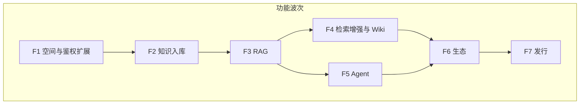

# 实施 ②：对标功能实现

> 前置：[01-骨架复刻适配](./01-骨架复刻适配.md) DoD 通过。  
> 目标：在 **MAF + mooSQL + Hangfire + admin 式 JWT** 之上，按 WeKnora v0.9.0 **产品能力**分波实现，尽量让 `src/sync/frontend` 主路径可用。  
> 对照：上游 `docs/architecture.md`、`website-docs/04-api`、纲领阶段 2–6。

---

## 1. 总策略

| 策略 | 说明 |
|------|------|
| **平台 vs 产品** | 登录/Permission/ApiResult 保持 admin 形；**知识库/对话/Agent** 优先兼容 WeKnora 路径与 SSE 事件；中间用适配层或双 Controllers |
| **数据** | 业务表执行 / 对齐 `src/sync/migrations`；mooSQL 映射已有表 |
| **异步** | 原 asynq 任务 → **Hangfire Job**（保留任务类型字符串便于对照） |
| **AI** | Chat/Agent 主路径走 **MAF**；Embedding/Rerank 旁路 Provider 注册表 |
| **解析** | 只调 `src/sync/docreader` gRPC，不重写 Python |
| **差异表** | 每波结束更新本节 §6；延期项必须显式登记 |

---

## 2. 波次详解

### F1 — 空间与鉴权扩展（衔接骨架）

**目的**：从「单租户 admin 登录」过渡到 WeKnora「用户 + 空间」最小可用。

| 项 | 内容 |
|----|------|
| 范围 | 空间 CRUD/成员/角色 Claims；可选 `X-Tenant-ID`；API Key 最小门闸；`GET /system/capabilities` |
| 上游对照 | `routes_auth_tenant`、`middleware/auth`、RBAC |
| 技术 | 平台 JWT Claims 扩展；Permission 码与空间角色映射表 |
| Hangfire | 无强制 |
| 门禁 | 种子用户可进默认空间；capabilities 返回稳定 JSON；sync 前端若仍撞登录形，登记适配项 |
| DoD | 集成测试：登录 → 带空间上下文调一受保护产品探针 API |

**适配注意**：若 WeKnora 登录 API 形与 admin `ApiResult` 冲突，本波明确二选一或做 `/api/v1/auth/*` 适配 Controller（推荐：**产品前缀适配，平台 `/api/auth/*` 保留 admin 形**）。

**F1 验收（已勾）**

- [x] 种子 admin 登录 JWT 含 `tid` / `srole`；默认空间可列  
- [x] `GET /api/system/capabilities` 与 `/api/v1/system/capabilities`  
- [x] `X-API-Key` / `X-Tenant-ID` 可进入受保护探针  
- [x] `/api/v1/auth/login|me` 适配入口存在  

---

### F2 — 知识入库闭环

| 项 | 内容 |
|----|------|
| 范围 | 知识库 CRUD；文件上传；Local（+ 可选 S3）存储；创建 Knowledge 行；Hangfire `document:process` |
| 处理链 | docreader gRPC → Markdown → chunker → Embedding → 写入检索后端（优先 **pgvector/Postgres**） |
| 上游对照 | `knowledge_create` / `knowledge_process`、`TypeDocumentProcess` |
| 技术 | Grpc.Net.Client；Hangfire 队列；mooSQL 映射 knowledges/chunks… |
| 门禁 | 上传样例文档后状态至可检索；分块列表 API 可用 |
| DoD | 契约测试：创建 KB → 上传 → 任务成功 → chunk count &gt; 0 |

**F2 进度（部分完成）**

- [x] 精简表 `KnKnowledgeBase` / `KnKnowledge` / `KnChunk` + 本地存储  
- [x] `POST /api/v1/knowledge-bases`、文件上传、`GET /api/v1/chunks/{id}`  
- [x] `document:process` 同步执行（Hangfire 关时 Inline）；本地文本分块 → `parse_status=completed`  
- [x] DocReader gRPC 客户端（`docreader.proto` codegen）+ 探针；Enabled=false 时回退本地文本  
- [x] Hangfire 开启时 `HangfireDocumentProcessEnqueue` 覆盖 Inline  
- [x] Embedding：`ITextEmbedder` + hashing；`OpenAiTextEmbedder`（`EmbeddingProvider=openai` + ApiKey）  
- [x] Postgres migrations runner：`src/cmd/migrate` + `scripts/migrate-postgres.ps1`  
- [x] `IChunkVectorIndex` + `Ai:VectorStore=json|pgvector`（json 默认；pgvector 未接线时回退 EmbeddingJson）  
- [ ] 真 pgvector 索引与业务表双轨映射  

---

### F3 — RAG 最小全链路

| 项 | 内容 |
|----|------|
| 范围 | 会话/消息；`knowledge-chat` SSE；chat_pipeline 核心事件子集 |
| 事件最小集 | `LOAD_HISTORY` → 检索 →（可选 rerank）→ `CHAT_COMPLETION_STREAM` + 引用 |
| AI | MAF/OpenAI 兼容流式生成；Embedding 同 F2 |
| 上游对照 | `session_knowledge_qa`、`chat_pipeline/`、`frontend/.../streame.ts` |
| 门禁 | sync 前端（或录制客户端）能打出流式回答与引用 |
| DoD | SSE 黄金片段断言；与 F2 样例库端到端 |

**pipeline 实现建议**：先做有序插件列表（C#），事件名对齐上游；不必一次插件全量。

**F3 进度（最小骨架已冒烟）**

- [x] `KnSession` / `KnMessage`；`POST/GET /api/v1/sessions`、`GET .../messages`  
- [x] `POST /api/v1/knowledge-chat/:id` SSE：`load_history` → `session_title` → `references` → `answer*` → `complete`  
- [x] `POST /api/v1/knowledge-search`（关键词 + hashing 向量混合分）  
- [x] 混合检索 + lexical rerank（`Ai:RerankEnabled`）+ MAF/Placeholder 流式  
- [ ] 对齐上游完整 `response_type` 集  
- [x] 检索经 `IChunkVectorIndex`（`Ai:VectorStore` 可切 json/pgvector 回退）  
- [ ] 外部 Rerank 模型 / 真 pgvector SQL  

---

### F4 — 检索增强与 Wiki

| 项 | 内容 |
|----|------|
| 范围 | 混合检索/重排；FAQ/标签/分块编辑；多检索引擎注册表（第二引擎可选）；Wiki ingest + 浏览 API |
| Hangfire | `wiki:ingest` / `wiki:finalize`、enrichment 类任务 |
| 门禁 | 知识库设置主路径 + Wiki 只读浏览可用 |
| 可延期 | Neo4j GraphRAG、多模态 embedding 全量 |

**F4 进度（最小骨架已冒烟）**

- [x] 分块：`GET/PUT/DELETE /api/v1/chunks/...`、`GET .../chunks/by-id/{id}`；更新时重算 embedding  
- [x] 知识列表：`GET /api/v1/knowledge-bases/{id}/knowledge`  
- [x] Wiki：`KnWikiPage` + `POST/GET/PUT /api/v1/wiki/pages`（含 `by-slug`）；capabilities `wiki=true`  
- [x] 标签：`POST/GET/DELETE /api/v1/knowledge-bases/{id}/tags`  
- [x] FAQ：`POST/GET/PUT/DELETE /api/v1/knowledge-bases/{id}/faq/entries`  
- [x] `wiki:ingest`：`POST /api/v1/wiki/ingest` + `WikiIngestJob`（Inline；Hangfire 开启时入队）  
- [x] `wiki:finalize`：`POST /api/v1/wiki/finalize` + `WikiFinalizeJob`（标记 `finalized` + 重建 `_index`；Inline/Hangfire）  
- [x] Wiki 图谱：`GET /api/v1/wiki/graph`（`[[slug]]` / `/wiki/slug` 出链，仅保留已存在页面边）  
- [x] 分块回滚：`KnChunkRevision` + `GET …/revisions` + `POST …/revert`（编辑前快照；可选 `revision`/`expectedRevision`）  

---

### F5 — Agent 主体

| 项 | 内容 |
|----|------|
| 范围 | MAF Agent + 工具：`search_knowledge` / `read_document` / `list_documents`；`agent-chat` SSE；自定义 Agent 最小 CRUD |
| 后续同波或 F5b | 出站 MCP；入站 `/mcp/:id`；HITL 审批；会话追加/分叉/回滚；Docker 沙箱一种 |
| 上游对照 | `internal/agent/**`、`mcpserver` |
| 门禁 | Agent 对话主路径 + 工具进度事件可被前端消费 |
| 可延期 | 技能市场全量、E2B/Cube、本机 BrowserSkill |

**F5 进度（最小骨架已冒烟）**

- [x] `KnAgent` CRUD：`POST/GET /api/v1/agents`  
- [x] 工具：`search_knowledge` / `list_documents` / `read_document`（`KnowledgeAgentTools`）  
- [x] `POST /api/v1/agent-chat/:id` SSE：`thinking` → `tool_call`/`tool_result` → `answer` → `complete`  
- [x] F5b：`Ai:AgentToolMode=native` → MAF `AIFunction` + `UseFunctionInvocation`；Placeholder 模拟 FC；`orchestrated` 可回退  
- [x] F5c：出站 `mcp-services` CRUD/test/tools；入站 `mcp-endpoints` + `POST /mcp/{id}` JSON-RPC stub；capabilities `mcpServer=true`  
- [x] F5c：HITL `tool_approval_required/resolved` + `sessions/.../tool-approvals`（`Ai:HitlEnabled`，timeout=0 自动批准）  
- [x] F5d：`KnSandboxConfig` + `/api/v1/sandbox-configs` CRUD；`.../sandboxes` inventory stub；`.../probe`；capabilities `sandbox=true`（host|docker|remote）  
- [x] F5e：host `Process` runtime + `POST .../exec`；Agent 工具 `shell_exec`（需 `sandbox_config_id`）；probe 实测 `echo ok`；docker/remote 仍 stub  
- [x] F5f：出站 `McpOutboundDialer`（initialize + tools/list JSON-RPC）；`mcp-services/.../test|tools` 真实 dial；可选 `authToken`；stdio stub  
- [x] F5g：`POST …/mcp-services/{id}/tools/call`；入站 `/mcp/{id}` 支持 `tools/call`（`echo` / `search_knowledge` stub）  
- [x] F5h：`DockerSandboxRunner`（`docker run --rm --network none`）；无 CLI 时明确 `docker not available`；remote 仍 stub  
- [x] F5i：入站 `/mcp/{id}` `search_knowledge` → `KnowledgeAgentTools` / 混合检索（非 stub）  
- [x] F5j：入站 `GET /mcp/{id}/sse` 握手（`event: endpoint` → POST JSON-RPC URL）  
- [x] F5k：出站 `transport=sse` dial — GET 解析 `endpoint` 事件后再 POST initialize/tools/list/call  
- [x] F5l：入站 SSE 长连接心跳（`interval_sec`/`max_sec`，comment + `event: ping`）  
- [x] F5m：Docker 长会话 `…/sessions` CRUD-ish（run -d / exec / rm；无 Docker 时明确报错）  
- [ ] MCP 客户端缓存  

---

### F6 — 生态与自动化

| 项 | 内容 |
|----|------|
| 数据源 | 按批：RSS → Confluence/GitLab → 飞书/Notion/…（每批独立门禁） |
| IM / Embed | 回调验签 + 渠道配置；Embed token |
| 记忆 / 自动化 | Hangfire Recurring + 执行记录；memory extract Job |
| 协作 / 可观测 | 多智能体；Langfuse/OTel；审计与任务面板（Hangfire Dashboard + 业务查询） |
| 门禁 | 对标清单差异表清零或明示延期 |

**F6 进度（RSS 最小已冒烟）**

- [x] `KnDatasource` + `POST/GET/DELETE /api/v1/datasources`  
- [x] `POST .../sync` → `DatasourceSyncJob`（`datasource:sync`；Inline/Hangfire）  
- [x] RSS/Atom 解析 → 写入知识库并入队 `document:process`；guid 去重  
- [x] `GET /api/v1/datasources/sample-feed`；capabilities `datasource=true`  
- [x] Embed：`/api/v1/embed-channels` CRUD；公开 `embed/{id}/config|sessions|knowledge-chat`（`X-Embed-Token`）；capabilities `embed=true`  
- [x] Memory：`KnMemory` + `POST /sessions/{id}/memory/extract`（`memory:extract` Job）+ `GET/DELETE /memories`；capabilities `memory=true`  
- [x] IM：`/api/v1/im-channels` CRUD；公开 `im/callback/{id}`（HMAC `X-IM-Signature` + challenge）；capabilities `im=true`  
- [x] GitLab：`type=gitlab` + `sample-gitlab-tree` + sync 导入 blob 为知识  
- [x] Confluence：`type=confluence` + `sample-confluence-pages` + sync 导入 page 为知识  
- [x] 飞书：`type=feishu` + `sample-feishu-docs` + sync 导入 doc 为知识  
- [x] Memory LLM 蒸馏：`Ai:MemoryExtractMode=llm|heuristic`（OpenAI 或 Placeholder 轻量规则；`source=session-llm`）  
- [ ] 可观测；厂商 IM 深化  

---

### F7 — 发行与 Lite

| 项 | 内容 |
|----|------|
| 部署 | Compose/Helm 中 `app` 换 .NET 镜像；对接 sync frontend/docreader |
| Lite | SQLite + Hangfire.MooSql；capabilities 关闭矩阵 |
| 其它 | CLI/SDK、性能基线、升级说明、安全加固 |
| 门禁 | 替换部署文档 + 回归报告 |

---

## 3. 工作包映射（横纵）

| 纲领 WP | 波次 | 优先级 |
|---------|------|--------|
| WP-Auth（空间/API Key） | F1 | P0 |
| WP-KB-Ingest | F2 | P0 |
| WP-Models（Chat/Embed） | F2–F3 | P0 |
| WP-RAG | F3 | P0 |
| WP-Retrieve | F3–F4 | P0–P1 |
| WP-Wiki | F4 | P1 |
| WP-Agent / WP-MCP / WP-Sandbox | F5 | P1 |
| WP-Datasource / WP-IM-Embed / WP-Memory-Auto / WP-Ops | F6 | P2 |
| WP-Lite-Desktop / WP-CLI-SDK | F7 | P3 |

---

## 4. Hangfire 任务对照（初稿）

| 上游任务类型 | Hangfire 建议 | 波次 |
|--------------|---------------|------|
| `document:process` | `DocumentProcessJob` | F2 |
| `temporary_document:process` | 同类 Job | F3 |
| `wiki:ingest` / `wiki:finalize` | Wiki Jobs | F4 |
| `datasource:sync` | Sync Job + Recurring | F6 |
| `memory:extract` | Memory Job | F6 |
| 其它 enrichment | 按队列拆 Job 或同队列多 handler | F4+ |

载荷 JSON 尽量与上游字段兼容，便于对照日志与重放。

---

## 5. 每波工程纪律

1. **先契约后实现**：产品 API 补 OpenAPI/录制用例；SSE 补黄金片段。  
2. **禁止改 `src/sync/**` 业务代码**；登录适配只加后端适配或后续单独评估前端补丁流程。  
3. **单波可合并 PR**，但门禁未过不得宣称该波完成。  
4. **差异表**（§6）当日更新。  
5. 从 admin 再抽代码时仍遵守「复刻范式不搬巨石」。

---

## 6. 对标差异表（活文档）

> 实施中维护；初始为空模板。

| 能力 | 上游状态 | sail-nora | 波次 | 状态 | 备注 |
|------|----------|-----------|------|------|------|
| 平台登录 JWT | WeKnora 形 | admin 形 + `/api/v1/auth/*` 适配；`tid`/`srole` Claims；空间/API Key/`X-Tenant-ID`；capabilities | F1 | 完成 | sync 前端登录形差异仍可能存在，登录体以 ApiResult 为准 |
| 知识库 CRUD | ✓ | 精简表 Kn* + `/api/v1/knowledge-bases` | F2 | 进行中 | 完整 migrations/Postgres 仍待 |
| 文档处理 | asynq `document:process` | Inline/Hangfire 同名任务 + 本地文本分块 | F2 | 进行中 | docreader gRPC Read 未接线，探针已留 |
| RAG SSE | ✓ | sessions + knowledge-chat SSE + knowledge-search 混合检索 | F3 | 进行中 | 真 pgvector SQL / 外部 rerank / 完整事件集仍待 |
| Wiki | ✓ | KnWikiPage + pages CRUD；FAQ/标签；ingest/finalize；graph；chunk revert | F4 | 进行中 | 图谱增强仍可迭代 |
| Agent + 核心工具 | ✓ | agent-chat SSE；native FC + HITL；host/docker shell + 长会话 API | F5 | 进行中 | 无 Docker 环境仅 API/报错冒烟 |
| 内置 MCP | ✓ | dial + tools/call + 入站真检索 + SSE 握手/出站 dial + 心跳 | F5 | 进行中 | 客户端缓存仍待 |
| 数据源（列举） | ✓ | RSS + GitLab + Confluence + Feishu sync | F6 | 进行中 | Notion 等仍待 |
| Memory 蒸馏 | ✓ | heuristic + llm 模式（`Ai:MemoryExtractMode`） | F6 | 进行中 | 真模型蒸馏质量仍待调 |
| … | | | | | |

---

## 7. 建议排期视图（相对）

| 波次 | 相对工期（示意） | 依赖 |
|------|------------------|------|
| F1 | 短 | 骨架完成 |
| F2 | 中 | F1、docreader 可连、迁移可跑 |
| F3 | 中 | F2、MAF/模型可连 |
| F4 | 中–长 | F3 |
| F5 | 长 | F3（可不阻塞 F4） |
| F6 | 长（可并行多连接器） | F4/F5 主路径 |
| F7 | 中 | F6 差异表收敛 |

具体人天不在本文绑定；以门禁为准。

---

## 8. 与纲领阶段对应

| 纲领阶段 | 本实施波次 |
|----------|------------|
| 0–1 奠基/底座 | 文档 01 骨架 + 本文件 F1 |
| 2 RAG 闭环 | F2 + F3 |
| 3 检索/Wiki | F4 |
| 4 Agent | F5 |
| 5 生态 | F6 |
| 6 发行/Lite | F7 |

---

## 9. 下一行动

1. F5 续：MCP 客户端工具缓存。  
2. F6 续：可观测（OTel/审计）；厂商 IM 深化。  
3. F2/F3 余量：真 pgvector SQL、外部 Rerank、完整 SSE 事件集。
