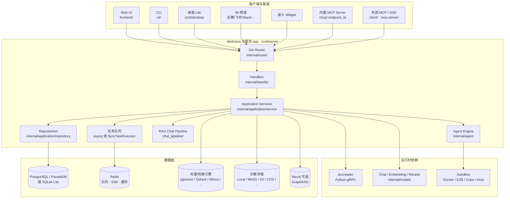
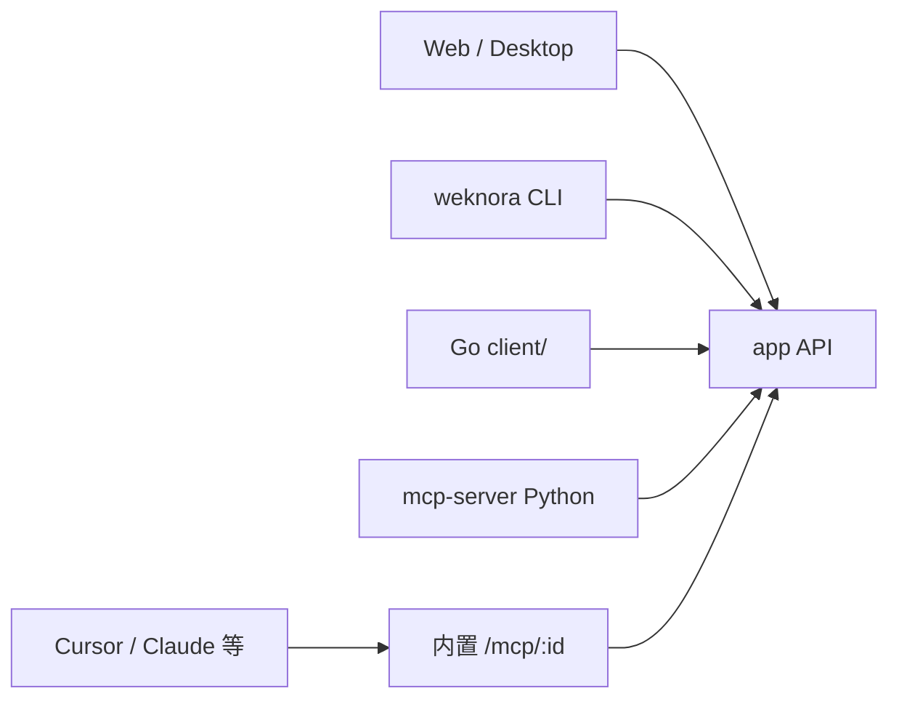

# WeKnora 工程架构导读

> 面向开发者的代码与系统架构说明，基于仓库当前主线（v0.9.0）整理。  
> 产品级架构说明见官网文档：[架构总览](https://weknora.weixin.qq.com/docs/02-architecture/01-overview)；扩展点与开发流程见 [`website-docs/06-development/`](../website-docs/06-development/01-dev-guide.md)。

本文帮助你在打开仓库后建立完整心智模型：系统由哪些进程组成、请求如何穿过各层、知识如何入库与检索、Agent 如何调用工具，以及 Standard / Lite 两种部署形态的差异。

---

## 1. 项目定位

**WeKnora（维娜拉）** 是腾讯开源的企业级知识管理框架。同一套知识库支撑三类能力：

| 能力 | 含义 | 代码主入口 |
|------|------|------------|
| **RAG 快速问答** | 混合检索 + 重排 + 流式生成，回答可引用原文 | `internal/application/service/session_knowledge_qa.go` + `chat_pipeline/` |
| **Agent 智能推理** | ReAct 多步规划，调用检索、沙箱、MCP、技能、本机浏览器等 | `internal/agent/engine.go` + `session_agent_qa.go` |
| **Wiki 知识整理** | 从文档生成可浏览 Wiki 与图谱，支持版本回滚 | `WikiPageService` / `WikiIngestService` |

核心设计原则：

- **模块化解耦、可替换**：解析器、分块、检索引擎、模型厂商、存储、数据源、IM 均通过接口注册。
- **主服务单体 + 可插拔运行时**：一个 Go 进程承载 API、业务编排与任务消费；向量库 / 对象存储 / 沙箱按配置外挂。
- **数据留在你的环境**：支持 Docker Compose、Helm、Lite 单二进制与桌面版私有化部署。

---

## 2. 系统全景

### 2.1 逻辑架构



官方示意 SVG：[`docs/images/readme/architecture-cn-light.svg`](./images/readme/architecture-cn-light.svg)。

### 2.2 进程与技术栈

| 组件 | 目录 | 技术 | 职责 |
|------|------|------|------|
| **app** | `cmd/server` + `internal/` | Go 1.26、Gin、uber/dig、GORM、asynq | HTTP API、业务编排、任务 Worker、内置 MCP、IM 回调 |
| **frontend** | `frontend/` | Vue 3、Pinia、Vite、TDesign | Web 控制台；生产由 nginx 反代 `/api` |
| **docreader** | `docreader/` | Python ≥3.10、gRPC、uv | 文档 → Markdown + 图片；分块/OCR/VLM 多在 Go 侧完成 |
| **cli** | `cli/`（独立 module） | Go、Cobra | 终端客户端、`weknora mcp` |
| **client** | `client/` | Go SDK | 程序化调用 REST/SSE |
| **mcp-server** | `mcp-server/` | Python | 独立 MCP 桥（compose `full` profile）；空间内置 MCP 已由 Go `internal/mcpserver` 承接 |
| **desktop** | `cmd/desktop` | Wails v2 | Lite 桌面壳，内嵌 Gin + 打包前端 |

---

## 3. 仓库目录地图

```text
WeKnora/
├── cmd/
│   ├── server/          # 主入口（标准 / Lite 同一代码路径，edition 由 ldflags 注入）
│   ├── desktop/         # Wails 桌面
│   └── milvus-migrate/  # 运维工具
├── internal/            # 后端核心（见第 4 节）
├── frontend/            # Vue SPA
├── docreader/           # Python 解析服务
├── cli/ · client/       # 终端与 Go SDK
├── config/              # config.yaml、prompt 模板
├── migrations/          # postgres versioned + sqlite + 遗留 mysql
├── docker/ · helm/      # 镜像与 K8s Chart
├── website-docs/        # 产品/开发文档源（官网文档站）
├── docs/                # 工程资源：Swagger、Lite 说明、设计稿、本文
├── examples/            # 技能与 MCP 示例
└── docker-compose.yml   # 标准部署拓扑
```

---

## 4. 后端分层

### 4.1 请求路径

```text
HTTP / WS / SSE
    ↓
Gin Engine（internal/router）
  · 全局：CORS、RequestID、Logger、Recovery、ErrorHandler
  · 预鉴权：/health、Swagger、IM 回调、Embed、/mcp/、沙箱 WS、Lite 静态资源
  · middleware.Auth → Audit → 路由级 RBAC
    ↓
Handler（internal/handler · handler/session）
  · 参数绑定、权限辅助、SSE 接线
    ↓
Service 接口（internal/types/interfaces）
    ↓
Application Service（internal/application/service）
  · 业务规则、事务、入队、调用 Agent / Pipeline / 模型
    ↓
Repository（internal/application/repository）
  · GORM 元数据 + retriever/* 向量/关键词引擎
    ↓
基础设施：DB · Redis · 对象存储 · docparser · models · sandbox · MCP
```

依赖注入：`go.uber.org/dig`，装配中枢为 [`internal/container/container.go`](../internal/container/container.go) 的 `BuildContainer()`。

### 4.2 启动顺序

入口：[`cmd/server/main.go`](../cmd/server/main.go)

1. `envfile.Load`（Lite 自动加载 `.env.lite`；标准版尊重 `ENV_FILE`）
2. 日志 / Gin 模式 / 启动环境横幅
3. `container.BuildContainer` — 注册 DB、Redis、仓库、服务、Handler、Router、Asynq 或同步执行器
4. `runStartupBootstrap` — 如系统管理员提升等一次性钩子
5. 监听 `cfg.Server.Host:Port`，启动模型目录刷新、system_settings Redis 订阅
6. 信号优雅关闭：`Shutdown` + `ResourceCleaner.Cleanup`

**无 CLI 子命令**：行为几乎全由环境变量与 `config/config.yaml` 驱动。

### 4.3 `internal/` 包职责速查

| 包 | 职责 |
|----|------|
| `config` | YAML + 环境变量配置 |
| `container` | dig 装配与资源清理 |
| `router` | 路由分组、RBAC、asynq / SyncTask |
| `handler` | HTTP 适配器 |
| `application/service` | 领域服务（知识、会话、Wiki、MCP、记忆、自动化…） |
| `application/repository` | 持久化与 `retriever/*` 引擎实现 |
| `agent` | ReAct 引擎、工具、技能、协作、HITL 审批 |
| `models` | Chat / Embedding / Rerank / VLM / ASR 与厂商适配 |
| `infrastructure/docparser` | 调用 docreader / 进程内 anydoc 等 |
| `infrastructure/chunker` | 分块策略 |
| `infrastructure/web_search` · `web_fetch` | 联网搜索与网页抓取 |
| `datasource` | 飞书 / Confluence / GitLab / Notion / RSS 等同步 |
| `mcp` · `mcpserver` | 出站 MCP 客户端 + 入站空间 MCP 端点 |
| `sandbox` · `localsandbox` | 远程/本机沙箱 |
| `im` | 各 IM 适配器 |
| `stream` | SSE 事件缓冲（Redis 或内存） |
| `middleware` | 鉴权、审计、asynq 死信等 |
| `database` | 迁移执行（postgres / sqlite） |
| `types` | DTO、任务类型、上下文键、服务接口 |
| `tracing/langfuse` | 可观测性 |
| `automation` | 定时 / 一次性自动化任务 |

---

## 5. API 与鉴权

### 5.1 路由组织

路由器：[`internal/router/router.go`](../internal/router/router.go)，业务路由拆在 `routes_*.go`：

| 文件 | 覆盖范围 |
|------|----------|
| `routes_auth_tenant.go` | 登录注册、租户/空间、成员邀请 |
| `routes_knowledge.go` | 知识库、文档、分块、标签、FAQ |
| `routes_chat.go` | 会话、消息、知识问答 / Agent 问答 |
| `routes_agent.go` | 自定义 Agent、技能 |
| `routes_mcp_endpoint.go` | MCP 服务与对外端点 |
| `routes_memory.go` | 长期记忆 |
| `routes_automation.go` | 自动化 |
| `routes_infra.go` | 模型、向量库、存储、数据源、系统设置 |
| `routes_graph.go` | 知识图谱 |

前缀统一为 **`/api/v1`**。Swagger 由 `make docs` 生成至 `docs/swagger.*`。

### 5.2 鉴权与 RBAC

- **JWT Bearer**、**X-API-Key**（空间 Key / 平台 Key + `X-Tenant-ID`）、Embed Token、OIDC。
- 中间件：[`internal/middleware/auth.go`](../internal/middleware/auth.go)。
- 空间内四级角色：`Owner` / `Admin` / `Contributor` / `Viewer`；路由守卫见 `internal/router/rbac.go`。
- API Key 按能力矩阵限制（如 chat、ingest）。
- 部署能力探测：`GET /system/capabilities`，前端据此做 Lite / 功能门控。

---

## 6. 核心业务链路

### 6.1 文档入库（Ingest）

```text
POST /api/v1/knowledge-bases/:id/knowledge/file
  → KnowledgeHandler.CreateKnowledgeFromFile
  → knowledgeService：FileService 存文件 → 写 Knowledge 行（processing）
  → TaskEnqueuer.Enqueue(TypeDocumentProcess)
        │
        ▼  Worker（asynq 或进程内 goroutine）
  ProcessDocument（knowledge_process.go）
  → docparser 转 Markdown
  → chunker 分块
  → Embedding 批量向量化
  → RetrieveEngineRegistry 建索引
  → 入队后处理：图谱抽取、多模态、自动标签、摘要/问题生成、Wiki ingest 等
```

关键文件：

- 创建：`internal/application/service/knowledge_create.go`
- 处理：`internal/application/service/knowledge_process.go`
- 任务常量：`internal/types/task.go`

### 6.2 RAG 快速问答

```text
POST /api/v1/knowledge-chat/:session_id  （SSE）
  → session.Handler.KnowledgeQA
  → sessionService.KnowledgeQA
  → chatpipeline.EventManager 顺序触发插件事件：

  LOAD_HISTORY → MEMORY_RECALL → QUERY_UNDERSTAND
    → CHUNK_SEARCH_PARALLEL → CHUNK_RERANK
    →（可选 WEB_FETCH）→ CHUNK_MERGE → FILTER_TOP_K
    → INTO_CHAT_MESSAGE → CHAT_COMPLETION_STREAM
```

插件目录：`internal/application/service/chat_pipeline/`。  
流式事件经 `internal/stream` 推到客户端；前端用 `@microsoft/fetch-event-source` 消费（`frontend/src/api/chat/streame.ts`）。

### 6.3 Agent 工具循环

```text
POST /api/v1/agent-chat/:session_id  （SSE）
  → sessionService.AgentQA
  → agentService.CreateAgentEngine（装配工具 / MCP / 沙箱 / 技能）
  → agent.AgentEngine.Execute
       循环：LLM 决策 → ToolRegistry 执行 → 观察 → 直至 final answer
  → 事件经 EventBus / StreamManager 推送（工具进度、审批、协作子任务等）
```

工具注册：`internal/agent/tools/`（如 `search_knowledge`、`read_document`、沙箱 shell/文件、Wiki、记忆、联网等）。  
人机审批与挂起：`internal/agent/approval`、`internal/agent/hitl`。  
多智能体协作：`internal/agent/collaboration`。

### 6.4 Wiki

- 开启 Wiki 后，入库流水线可触发 `TypeWikiIngest` / `TypeWikiFinalize`（独立 wiki asynq 池）。
- 页面、文件夹、修订表见迁移与 `WikiPageService`。
- Agent 可通过 Wiki 工具读写页面；前端在知识库视图内嵌 `WikiBrowser`。

### 6.5 数据源同步

`DataSourceService` + `internal/datasource/connector`：定时或手动同步外部内容，再走同一解析/分块/索引链路。连接器在 `container` 的 `initConnectorRegistry` 注册。

---

## 7. 任务队列与后台

### 7.1 Standard（有 Redis）

- 库：[`hibiken/asynq`](https://github.com/hibiken/asynq)
- 装配：`internal/router/task.go` → `RunAsynqServer`
- 多 Worker 池：core / postprocess / enrichment / maintenance / shared / wiki
- 队列示例：`default`、`chat_attachment`、`postprocess`、`multimodal`、`graph`、`wiki`、`sync`、`low` …
- 死信、Inspector、运行时队列面板：任务运维 API + 前端系统设置

### 7.2 Lite（无 Redis）

- `internal/router/sync_task.go` 的 **`SyncTaskExecutor`**：同一套 Handler 在进程内 goroutine 执行
- Stream Manager 默认内存；无跨实例取消/Inspector 能力

主要任务类型 → Handler 映射见 `internal/types/task.go`（如 `document:process`、`datasource:sync`、`wiki:ingest`、`memory:extract`）。

---

## 8. 数据与存储

### 8.1 主库

| `DB_DRIVER` | 场景 |
|-------------|------|
| `postgres` | 标准模式；官方 compose 默认 **ParadeDB**（pg_search BM25 + pgvector） |
| `sqlite` | Lite；`sqlite-vec` + FTS5 |

迁移：

- PostgreSQL：`migrations/versioned/`（golang-migrate）
- SQLite：`migrations/sqlite/`
- 说明详见 [`website-docs/06-development/02-database-schema.md`](../website-docs/06-development/02-database-schema.md)

核心实体（概念层）：`tenants`（空间）、`users`、`knowledge_bases`、`knowledges`、`chunks`、`embeddings`、`sessions`/`messages`、`wiki_*`、`custom_agents`、`mcp_*`、`tenant_skills`、记忆表、任务死信等。

### 8.2 检索引擎

由 `RETRIEVE_DRIVER` 与空间级 `VectorStore` 配置决定，实现位于：

`internal/application/repository/retriever/{postgres,elasticsearch,opensearch,qdrant,milvus,weaviate,doris,sqlite,tencentvectordb,...}`

注册表：`internal/application/service/retriever/registry.go`。支持混合检索、跨库扇出、重排。

### 8.3 对象存储

`internal/application/service/file/`：Local、MinIO、S3、COS、OSS、TOS、KS3、OBS 等；支持每空间多存储后端实例。

### 8.4 其他

- **Neo4j**：可选 GraphRAG
- **DuckDB**：分析类能力（依赖 CGO）
- **凭据**：AES-256-GCM 加密存储（MCP、数据源等）

---

## 9. 前端架构

| 区域 | 路径 | 说明 |
|------|------|------|
| 入口 | `frontend/src/main.ts` | Pinia、Router、i18n、TDesign |
| 路由 | `frontend/src/router/index.ts` | 鉴权与 capability 守卫；`BASE_URL` 支持子路径部署 |
| 壳 | `views/platform/index.vue` | 侧栏、设置弹层、助手、上传 |
| 状态 | `stores/*.ts` | auth、knowledge、assistant、deploymentCapabilities… |
| API | `api/**` + `utils/request.ts` | Axios；Bearer + `X-Tenant-ID` |
| SSE | `api/chat/streame.ts` | Agent/RAG 流式；断线续传 `continue-stream` |
| 桌面 | `wailsjs/**` | Lite 桌面绑定 |

主要业务视图：

- 知识库：`views/knowledge/`（含 Wiki 标签页）
- 对话：`views/chat/`
- Agent：`views/agent/`
- 设置 / 系统管理：`views/settings/`、`views/system/`

生产流量：浏览器 → **frontend nginx :80** → `/api`、`/files`、`/mcp/`、沙箱 WS 反代到 **app :8080**。  
开发：`make dev-frontend`（Vite :5173）代理到本地后端。

---

## 10. 部署拓扑

### 10.1 Docker Compose（标准）

默认核心服务：

```text
frontend (:80) → app (:8080) → docreader (:50051)
                              → postgres (ParadeDB)
                              → redis
```

常用 profile：`neo4j`、`minio`、`langfuse`、`qdrant`/`milvus`/`weaviate`、`searxng`、`full` 等。  
开发依赖栈：`docker-compose.dev.yml` + `scripts/dev.sh` / `make dev-*`。

### 10.2 Kubernetes

Chart：[`helm/`](../helm/) — 模板覆盖 app、frontend、docreader、postgres、redis、PVC、Ingress、可选 neo4j/minio/qdrant。

### 10.3 Lite / 桌面

| 项 | Lite |
|----|------|
| 构建 | `EDITION=lite` ldflags；常带 `sqlite_fts5`、CGO |
| 依赖 | SQLite + 内存队列；无独立 Postgres/Redis |
| UI | 二进制内嵌 `web/` 静态资源，或 Wails 加载 |
| 鉴权 | `auth/auto-setup`，可免注册 |
| 能力 | 组织协作、远程沙箱分配等由 capabilities 关闭 |

差异表：[`docs/LITE.md`](./LITE.md)。

### 10.4 客户端生态位置



---

## 11. 扩展点（如何改代码）

注册中枢多数在 `internal/container/container.go`。完整步骤见 [`website-docs/06-development/03-extension-points.md`](../website-docs/06-development/03-extension-points.md)。

| 扩展类型 | 位置 |
|----------|------|
| 文档解析器 | `docreader/parser/registry.py` |
| 分块策略 | `internal/infrastructure/chunker` |
| 检索引擎 | `application/repository/retriever` + registry |
| 模型厂商 | `internal/models/providers` |
| 联网搜索 | `infrastructure/web_search` |
| 数据源连接器 | `datasource/connector` |
| IM 适配器 | `internal/im` |
| Agent 工具 | `internal/agent/tools` |
| 存储后端 | `application/service/file` |

---

## 12. 阅读路径建议

按目标选入口，避免一次性通读全库：

1. **弄清启动与装配**  
   `cmd/server/main.go` → `internal/container/container.go` → `internal/router/router.go`

2. **跟一条上传文档请求**  
   `handler` 知识创建 → `knowledge_create.go` → `knowledge_process.go` → retriever

3. **跟一条对话**  
   RAG：`handler/session/qa.go` → `session_knowledge_qa.go` → `chat_pipeline/`  
   Agent：`session_agent_qa.go` → `agent/engine.go` → `agent/tools/`

4. **改前端某页**  
   `frontend/src/router/index.ts` → 对应 `views/` → `api/` → 后端路由

5. **加一种外部系统**  
   对照扩展点文档，实现接口并在 registry / container 注册，补测试

6. **理解 Standard vs Lite**  
   `docs/LITE.md` + `handler.Edition` + `SyncTaskExecutor` + capabilities API

---

## 13. 相关文档索引

| 文档 | 内容 |
|------|------|
| [`docs/README.md`](./README.md) | 本目录工程资源说明 |
| [`docs/LITE.md`](./LITE.md) | Lite 与标准版差异 |
| [`docs/design/`](./design/) | Agent 自动化、HITL、权限等设计稿 |
| [`website-docs/06-development/01-dev-guide.md`](../website-docs/06-development/01-dev-guide.md) | 本地开发、Makefile、compose |
| [`website-docs/06-development/02-database-schema.md`](../website-docs/06-development/02-database-schema.md) | 库表与迁移 |
| [`website-docs/06-development/03-extension-points.md`](../website-docs/06-development/03-extension-points.md) | 扩展点详解 |
| [`website-docs/04-api/01-api-overview.md`](../website-docs/04-api/01-api-overview.md) | API 参考 |
| 官网 [架构总览](https://weknora.weixin.qq.com/docs/02-architecture/01-overview) | 产品视角架构 |

---

## 14. 一句话心智模型

> **一个 Go 单体**通过 **Handler → Service → Repository** 编排业务；  
> **RAG** 走可插拔 **事件流水线**，**Agent** 走独立 **ReAct + ToolRegistry**；  
> **文档解析**外挂 Python **docreader**，**入库与后处理**走 **asynq（或 Lite 进程内队列）**；  
> **向量库 / 对象存储 / 沙箱 / 模型**均可替换；  
> **Vue 前端**与 **CLI / MCP / IM** 共用同一套 `/api/v1` 与 SSE。

---

*本文为仓库工程导读，随代码演进可能滞后；以源码与 `website-docs` 为准。*
